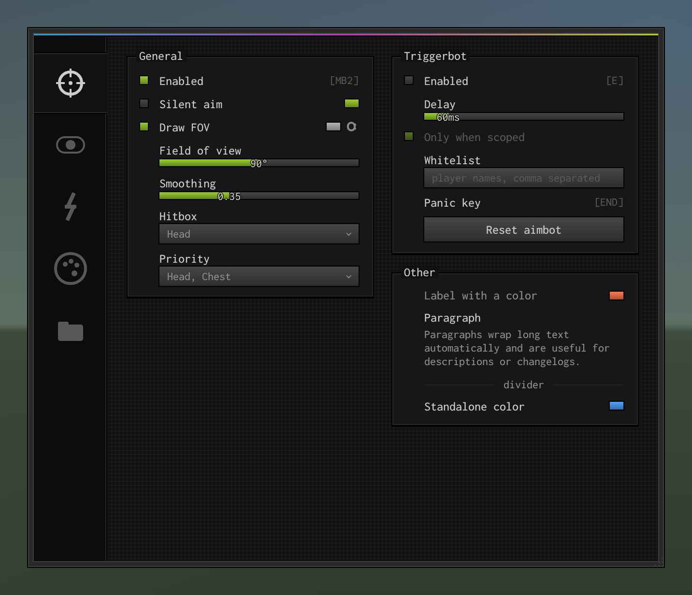

# Nova UI

A production-ready Roblox UI library (Luau) with **five complete skins**, a live **theme system**,
a robust **config system**, an **ESP preview**, and full **mobile support**.

> The name "Nova UI" is a placeholder – change it in **one place**: [`src/Meta.lua`](src/Meta.lua)
> (display name, folder name, export prefixes). Logo, title and texts come from your config / theme
> (no original logos, assets or brand names of the menus the skins are styled after are used).

| Skin | Look |
|---|---|
| **Classic** | compact square window, layered 1 px borders, animated rainbow bar, icon tab column, group boxes with embedded titles, tiny mono font, light green accent |
| **Modern** | wide blue-black window, sidebar with logo / categories / user card, top bar with sub-tabs, config selector, save button and search, rounded groups, pill switches, value bubbles, gear popouts |
| **Onetap** | dark anthracite, orange accent, text tab bar on top, flat groups, clean lines |
| **Fatal** | violet-black, pink/magenta gradients + glow, top tabs with an animated sliding underline |
| **Dashboard** | original design: top bar (page tabs, search, notification bell, avatar), collapsible sidebar categories, status cards, card groups, large primary buttons |

Every skin ships its own **loader**, notifications, dialogs, tooltips, watermark, keybind list,
floating mobile button and quick toggles.



More screenshots: [`docs/screenshots`](docs/screenshots) (see *Screenshots* below for how they are produced).

---

## Contents
1. [Quick start](#quick-start)
2. [Architecture](#architecture)
3. [API reference](#api-reference)
4. [Theme system & all theme keys](#theme-system)
5. [Config system](#config-system)
6. [Mobile](#mobile)
7. [ESP preview](#esp-preview)
8. [Create your own skin](#create-your-own-skin)
9. [Building, tests & screenshots](#building-tests--screenshots)

---

## Quick start

```lua
local UI = loadstring(game:HttpGet("https://raw.githubusercontent.com/Pander0212/CSGO-UI-Library-/main/dist/NovaUI.lua"))()

UI:Loader({ Skin = "Classic", Products = { { Name = "Universal", Status = "Undetected", Expires = "Never" } } })

local Win = UI:CreateWindow({ Title = "Nova UI", Skin = "Classic", ToggleKey = Enum.KeyCode.RightShift })
local Tab = Win:AddTab({ Name = "Aimbot", Icon = "crosshair", Category = "Combat" })
local G   = Tab:AddGroup({ Name = "General", Side = "Left" })

G:AddToggle({ Name = "Enabled", Flag = "aim_enabled", Default = true, Pinnable = true, Callback = print })
	:AddColorPicker({ Flag = "aim_color", Default = Color3.fromRGB(154, 205, 50) })
	:AddKeybind({ Flag = "aim_key", Default = "MB2", Mode = "Hold" })
G:AddSlider({ Name = "FOV", Flag = "aim_fov", Min = 0, Max = 180, Default = 90, Suffix = "°" })

Win:AddThemeTab()   -- skin switcher, presets, every theme key, export / import
Win:AddConfigTab()  -- configs, autoload, autosave, export / import
UI.Config:LoadAutoload()
```

A complete example with every component, the ESP preview, quick toggles and sub-tabs is in
[`example.lua`](example.lua).

---

## Architecture

```
src/
  Meta.lua                 name / folder / versions – the ONE place to rename the library
  init.lua                 library singleton (CreateWindow, SetSkin, Loader, Notify, Dialog, …)
  Core/                    Maid, Signal, Util, Tween, Theme, Flags, Registry, FS, Config, Icons, Input, Renderer
  Components/              shared LOGIC: Types (values), Element, Group, Tab/SubTab, Window
  Skins/Base/              reference renderers + primitives every skin extends
  Skins/<Name>/            Theme.lua (defaults + presets), Window.lua, Components.lua, Loader.lua, init.lua
  Mobile/                  detection, auto scale, floating button, quick toggles
  ESPPreview/              viewport preview + rig
  Tabs/                    ready-made Appearance + Config tabs
build/build.py             bundles src -> dist/NovaUI.lua
tools/preview/             Roblox API mock, tests, HTML renderer used for screenshots
```

* **Logic vs. presentation** – every component (Toggle, Slider, …) has *one* logic object
  (`Components/Element.lua` + `Components/Types.lua`: flag, callback, value normalisation,
  serialisation, `Set/Get`). Skins only render: they receive the element, call `element:Set(v)` on
  interaction and implement `view:Update(value)`.
* **Runtime skin switching** – `UI:SetSkin("Modern")` tears the presentation down and rebuilds it from
  the logic tree with a fade. Flag values, the active tab / sub-tab and the window position survive.
* **No hard-coded styling** – renderers bind instance properties to theme keys
  (`Theme:Bind(inst, "BackgroundColor3", "Panel")`); `Theme:Set` tweens every bound instance live.
* **Maid pattern** – every connection / instance is owned by a maid; `UI:Destroy()` cleans everything.
  Re-executing the script destroys the previous instance automatically.
* **Performance** – one shared set of input connections, one RenderStepped connection for animated
  gradients (only while one exists), one Heartbeat loop for rainbow colors (only while one is active),
  ESP preview steps only while visible, no per-frame work otherwise.
* **Parenting** – `gethui()` → `CoreGui` (pcall, `syn.protect_gui` when present) → `PlayerGui`.

---

## API reference

### Library (`UI`)

| Method | Description |
|---|---|
| `UI:CreateWindow(opts)` | `Title, Skin, Size (Vector2/UDim2), ToggleKey, LogoText, Logo, Subtitle, Username, UserInfo, Avatar, FloatingButton (bool/nil=auto), Watermark, KeybindList` → `Window` |
| `UI:Loader(opts)` | `Skin, Title, Subtitle, Username, Products = {{Name, Status, Expires, Game, Icon}}, Steps = {"text" or {Text, Duration, Run}}, AutoLoad, OnLoad(product), Yield (default true)` → handle `{Finished, Start(i), Close(), SetStatus(t)}` |
| `UI:SetSkin(name, {Instant})` | switch skin at runtime (fade) |
| `UI:RegisterSkin(skin)` / `UI:GetSkins()` | add a custom skin / list skins |
| `UI:Notify({Title, Content, Duration, Type, Icon})` | `Type = "Info" \| "Success" \| "Warning" \| "Error"` → `{Close()}` |
| `UI:Dialog({Title, Content, Buttons = {{Text, Primary, Callback}}})` | modal dialog → `{Close()}` |
| `UI:Confirm(title, text, onYes)` | confirm dialog shortcut |
| `UI:SetWatermark(bool, fields?)` | `fields = {Title, User, FPS, Ping, Time}` (draggable) |
| `UI:SetKeybindList(bool)` | overlay listing active keybinds (draggable) |
| `UI:GetESPSettings(flagMap?)` | current ESP preview settings |
| `UI:SetMobileMode("Auto"\|"Mobile"\|"Desktop")` / `UI:IsMobile()` | mobile override |
| `UI:Destroy()` (`UI:Unload()`) | remove everything |
| `UI.Flags.Values[flag]` | current value of every flag; `UI.Flags.Changed:Connect(fn(flag, value))` |
| `UI.Theme`, `UI.Config`, `UI.Icons`, `UI.SkinBase` | sub systems (see below) |

### Window

| Method | Description |
|---|---|
| `Win:AddTab({Name, Icon, Category, Description, StatusCards})` | tab (categories group tabs in sidebars) |
| `Win:AddThemeTab(opts)` / `Win:AddConfigTab(opts)` | ready-made tabs, styled by the current skin |
| `Win:SelectTab(tab or name, sub?)` | select tab / sub-tab |
| `Win:SetOpen(bool)` / `Win:Toggle()` / `Win:SetToggleKey(key)` | visibility (toggle key default `RightShift`) |
| `Win:SetSize(w, h)` / `Win:GetState()` / `Win:SetState(t)` | size & persisted state |
| `Win:Search(query)` / `Win:Focus(element)` | search elements / jump to one |

Windows are draggable (mouse + touch) and resizable (bottom-right grip).

### Tab / SubTab / Group

```lua
local tab = Win:AddTab({ Name = "Misc", Icon = "zap", Category = "Misc" })
local sub = tab:AddSubTab("Movement")              -- optional; tabs without sub-tabs get one implicitly
local group = sub:AddGroup({ Name = "Movement", Side = "Left" })   -- also tab:AddGroup(...)
```

### Elements

All elements accept `Name`, `Flag`, `Default`, `Callback`, `Tooltip`, `Disabled`, `Visible`,
`IgnoreConfig` (loaded silently – no callback) and `NoSave` (never saved), and return the element.
Common methods: `:Set(value, {Silent, Instant})`, `:Get()`, `:SetVisible(b)`, `:SetDisabled(b)`,
`:SetTooltip(text)`, `:OnChanged(fn)`, `:Destroy()`.

| Constructor | Options | Value |
|---|---|---|
| `AddToggle` | `Pinnable, PinLabel` | `boolean` |
| `AddSlider` | `Min, Max, Increment (or Rounding), Suffix, Format(v)` | `number` |
| `AddDropdown` | `Values, Multi, Searchable, AllowNull, Placeholder` + `:Refresh(values, keep)` | `string` / `{string}` |
| `AddTextbox` | `Placeholder, Numeric, Finished, ClearTextOnFocus, MaxLength` | `string` |
| `AddKeybind` | `Mode = "Toggle"\|"Hold"\|"Always", OnPress(state)` (right-click / long-press for mode) | `{Key, Mode}` |
| `AddColorPicker` | `Transparency` (HSV, hue, hex, alpha, rainbow) | `{Color, Transparency, Rainbow}` |
| `AddButton` | `Confirm, ConfirmText, Style = "Filled"\|"Outline"\|"Primary"` + `:Press()` | – |
| `AddLabel` | `Text, Color, Wrap, RichText` + `:SetText()` | – |
| `AddParagraph` | `Title, Content` + `:SetContent()` | – |
| `AddDivider` | `Text` | – |
| `AddESPPreview` | `Height, Flags (map), IdleRotation, IdleSpeed, PlayerName` | – |
| `AddESPSettings` | creates the standard `esp_*` flags used by the preview | – |

Addons (skeet style, chainable): `toggle:AddColorPicker(opts)`, `toggle:AddKeybind(opts)` (a keybind
attached to a toggle toggles / holds it), `label:AddColorPicker(...)`. Sub-options:
`local popout = toggle:AddSubOptions({Name})` → a gear icon opens a popout group (`popout:AddSlider(...)` …).

### Icons
Built-in vector icons (no assets): `crosshair target eye user users gear palette folder globe shield sword home bell search list star zap code save pin chevron(-up/-left/-right) close plus minus check info warning trash copy edit refresh download upload lock grid sliders play power clock box cube car skull map heart layers move dot logo`.
Any `rbxassetid://…` / number works as well. `UI.Icons.Register(name, assetIdOrDefinition)`.

---

## Theme system

```lua
UI.Theme:Set("Accent", Color3.fromRGB(255, 80, 80))        -- tweens every bound instance
UI.Theme:Set("Alpha.Panel", 0.2)                            -- every color key has an Alpha.<Key>
UI.Theme:Set("RainbowBar", { Animated = true, Speed = 0.5 })-- gradients: Enabled, Colors, Rotation, Animated, Speed
UI.Theme:Bind(myFrame, "BackgroundColor3", "Panel")         -- your own instances follow the theme too
UI.Theme:BindGradient(myGradient, "AccentGradient")
UI.Theme:ApplyPreset("Ocean")  UI.Theme:SavePreset("mine")  UI.Theme:Presets()
UI.Theme:ExportString() / UI.Theme:ImportString(s)          -- also copied via setclipboard in the theme tab
UI.Theme:Reset("Colors") / UI.Theme:Reset()                 -- per section / everything
UI.Theme.Changed:Connect(function(key, value) end)
```

* Each skin only provides default values (`Skins/<Name>/Theme.lua`) and presets.
* Changes are stored as *overrides* per skin (`Overrides[skin]`) – branding / notifications / sounds are
  global (`Overrides["*"]`). Configs and theme presets store these overrides.
* Gradient colors may reference color keys by name (`{ "Accent", "AccentDark" }`).
* Keys marked *rebuilds* change the layout structure; the UI rebuilds itself (debounced).

### All theme keys

**Colors**

| Key | Default (Base) | Notes |
|---|---|---|
| `Accent` | Color3 (0, 170, 255) | Main accent (checkbox fill, sliders, active tab) |
| `AccentDark` | Color3 (0, 110, 190) | Second accent, gradient end |
| `Background` | Color3 (16, 16, 20) | Window / content background |
| `BackgroundSecondary` | Color3 (12, 12, 16) | Sidebar / tab column |
| `Topbar` | Color3 (20, 20, 26) | Header / top bar |
| `Panel` | Color3 (22, 22, 28) | Group boxes, popups, cards |
| `PanelHeader` | Color3 (26, 26, 33) | Group header strip |
| `Border` | Color3 (40, 40, 50) | Default border |
| `BorderDark` | Color3 (0, 0, 0) | Outer / dark border |
| `BorderLight` | Color3 (60, 60, 72) | Inner / light border |
| `Element` | Color3 (30, 30, 38) | Input backgrounds (boxes, tracks) |
| `ElementHover` | Color3 (38, 38, 48) | Hovered input |
| `ElementActive` | Color3 (46, 46, 58) | Pressed / focused input |
| `Text` | Color3 (235, 235, 240) | Primary text |
| `TextDim` | Color3 (150, 150, 165) | Secondary text |
| `TextDisabled` | Color3 (85, 85, 95) | Disabled text |
| `TextOnAccent` | Color3 (255, 255, 255) | Text drawn on accent |
| `Divider` | Color3 (34, 34, 42) | Separator lines |
| `Knob` | Color3 (255, 255, 255) | Switch / slider knobs |
| `Shadow` | Color3 (0, 0, 0) | Drop shadow color |
| `Glow` | Color3 (0, 170, 255) | Glow color (Fatal) |
| `Success` | Color3 (60, 200, 120) | Success state |
| `Warning` | Color3 (240, 180, 40) | Warning state |
| `Error` | Color3 (230, 70, 80) | Error state |
| `Info` | Color3 (0, 170, 255) | Info state |
| `Tooltip` | Color3 (14, 14, 18) | Tooltip background |
| `Overlay` | Color3 (0, 0, 0) | Dialog backdrop |
| `Highlight` | Color3 (255, 255, 255) | White carrier used under gradients |

**AccentDark**

| Key | Default (Base) | Notes |
|---|---|---|
| `AccentGradient` | gradient | Accent gradient (fills, primary buttons) |

**Gradients**

| Key | Default (Base) | Notes |
|---|---|---|
| `RainbowBar` | gradient | Top rainbow bar (Classic) – colors / speed / animated |

**BackgroundSecondary**

| Key | Default (Base) | Notes |
|---|---|---|
| `BackgroundGradient` | gradient | Window background gradient |

**Element**

| Key | Default (Base) | Notes |
|---|---|---|
| `ElementGradient` | gradient | Input gradient (Classic look) |

**AccentDark**

| Key | Default (Base) | Notes |
|---|---|---|
| `HeaderGradient` | gradient | Logo / header gradient |

**Background**

| Key | Default (Base) | Notes |
|---|---|---|
| `BackgroundImage` | "" | Background image asset |
| `BackgroundImageTransparency` | 0.85 | Image transparency |
| `BackgroundTexture` | "None" | None / Grid / Scanlines / Diagonal *(rebuilds)* |
| `TextureTransparency` | 0.93 | Texture line transparency |
| `TextureSpacing` | 6 | Texture spacing (px) *(rebuilds)* |
| `WindowTransparency` | 0 | Overall window transparency |

**Fonts**

| Key | Default (Base) | Notes |
|---|---|---|
| `FontTitle` | "GothamBold" | Titles / headers font |
| `FontBody` | "Gotham" | Body font |
| `FontMono` | "Code" | Mono font (values, keybinds) |
| `TextSize` | 13 | Body text size |
| `TitleSize` | 14 | Title size |
| `SmallTextSize` | 11 | Small text size |

**Layout**

| Key | Default (Base) | Notes |
|---|---|---|
| `CornerRadius` | 6 | Window / group radius |
| `SmallCornerRadius` | 4 | Control radius |
| `BorderThickness` | 1 | Border thickness |
| `ShadowEnabled` | true | Drop shadows on/off |
| `ShadowTransparency` | 0.55 | Shadow strength |
| `WindowWidth` | 760 | Default window width |
| `WindowHeight` | 540 | Default window height |
| `UIScale` | 1 | Global UI scale |
| `SidebarWidth` | 180 | Sidebar / tab column width *(rebuilds)* |
| `Spacing` | 8 | Space between rows *(rebuilds)* |
| `Padding` | 12 | Page / group padding *(rebuilds)* |
| `ElementHeight` | 30 | Row height *(rebuilds)* |
| `GroupSpacing` | 10 | Space between groups *(rebuilds)* |

**Animation**

| Key | Default (Base) | Notes |
|---|---|---|
| `AnimationsEnabled` | true | Animations on/off |
| `AnimationSpeed` | 1 | Speed multiplier |
| `EasingStyle` | "Quint" | Easing style |
| `EasingDirection` | "Out" | Easing direction |

**Branding**

| Key | Default (Base) | Notes |
|---|---|---|
| `Title` | Meta.Name | Window title *(global, all skins)* |
| `Subtitle` | "" | Subtitle *(global, all skins)* |
| `LogoText` | "NOVA" | Logo text *(global, all skins)* |
| `LogoImage` | "" | Logo image (asset id) – replaces LogoText *(global, all skins)* |
| `Username` | "" | Shown user name (empty = LocalPlayer) *(global, all skins)* |
| `UserInfo` | "Expires: never" | Info line (e.g. expiry) *(global, all skins)* |
| `AvatarImage` | "" | Avatar (empty = LocalPlayer thumbnail) *(global, all skins)* |
| `LoaderTitle` | "" | Loader title (empty = Title) *(global, all skins)* |
| `LoaderSubtitle` | "Welcome back" | Loader greeting *(global, all skins)* |
| `LoaderStatus` | "Ready" | Loader idle status *(global, all skins)* |

**Notifications**

| Key | Default (Base) | Notes |
|---|---|---|
| `NotifyPosition` | "BottomRight" | Notification corner *(global, all skins)* |
| `NotifyDuration` | 4 | Default duration (s) *(global, all skins)* |
| `NotifyWidth` | 260 | Notification width |

**Sounds**

| Key | Default (Base) | Notes |
|---|---|---|
| `SoundsEnabled` | false | UI sounds on/off *(global, all skins)* |
| `SoundVolume` | 0.5 | Volume *(global, all skins)* |
| `SoundClick` | "rbxasset://sounds/electronicpingshort.wav" | Click sound id *(global, all skins)* |
| `SoundToggle` | "rbxasset://sounds/electronicpingshort.wav" | Toggle sound id *(global, all skins)* |
| `SoundNotify` | "rbxasset://sounds/electronicpingshort.wav" | Notification sound id *(global, all skins)* |

**Mobile**

| Key | Default (Base) | Notes |
|---|---|---|
| `MobileButtonSize` | 52 | Floating button size |
| `MobileButtonShape` | "Circle" | Circle / Rounded / Square |
| `TouchTarget` | 44 | Minimum touch target (pt) *(rebuilds)* |
| `QuickToggleShape` | "Rounded" | Quick toggle shape |
| `Colors` | "Gradients", "Background", "Fonts", "Layout", "Animation", "Branding", "Notifications", "Sounds" |  |

---

## Config system

* Folders: `NovaUI/<PlaceId>/configs/*.json`, `NovaUI/themes/*.json`, `NovaUI/settings.json`
  (`NovaUI` = `Meta.Folder`).
* Saved: every element with a flag (toggles, sliders, multi dropdowns, textboxes, keybinds incl. mode,
  color pickers incl. transparency + rainbow), quick toggles (pins, positions, sizes, opacity), window
  position / size / tab, floating button position, mobile mode, ESP preview camera, active skin and
  the full theme.
* Every file call is wrapped in `pcall`; without a file API everything works session-only (memory).
* Broken files produce a notification instead of an error. Old files are migrated (`version` field,
  `Config.Migrations[n]` upgrades n → n+1).
* Loading fires callbacks (except elements with `IgnoreConfig = true`, which load silently).

```lua
UI.Config:Save("legit")                  -- {Overwrite = false} to refuse existing names
UI.Config:Load("legit")
UI.Config:Delete / Rename(old, new) / Duplicate(name, new?) / List() / Exists(name)
UI.Config:SetAutoload("legit")  UI.Config:GetAutoload()  UI.Config:LoadAutoload()
UI.Config:SetAutoSave(true, 60)  UI.Config:SetSaveOnClose(true)
local s = UI.Config:Export()             -- "NOVA-CFG:{...}" (also copied to the clipboard)
UI.Config:Import(s, { SaveAs = "shared" })
```

Format (version 2):

```json
{
  "version": 2, "library": "Nova UI", "name": "legit", "saved": 1731500000, "skin": "Classic",
  "theme": { "skin": "Classic", "overrides": { "*": { "Title": "My hub" }, "Classic": { "Accent": "#9acd32" } } },
  "flags": { "aim_enabled": true, "aim_key": { "Key": "MB2", "Mode": "Hold" },
             "aim_color": { "Color": "#9acd32", "Transparency": 0, "Rainbow": false } },
  "window": { "x": 200, "y": 120, "w": 660, "h": 560, "tab": "Aimbot", "sub": "Main", "sizes": {} },
  "mobile": { "mode": "Auto", "button": { "x": 20, "y": 200 },
              "pins": { "aim_enabled": { "x": 140, "y": 50, "size": "M", "alpha": 0 } } },
  "esp": { "Yaw": 0.5, "Distance": 15 }
}
```

The config tab offers: list, save as new, load, overwrite (confirmation), delete (confirmation), rename,
duplicate, refresh, autoload set/clear, export/import, autosave + interval, save on close, menu key,
watermark / keybind list toggles and unload.

---

## Mobile

* Auto detection (`TouchEnabled` and no keyboard / small screen) + manual override
  (`UI:SetMobileMode`, appearance tab, saved in `settings.json`).
* Automatic `UIScale` (by screen width, ≥ 0.75), window height shrinks below the top bar inset
  (`GuiService:GetGuiInset`), pages scroll.
* Touch targets ≥ `TouchTarget` (44 pt) – rows grow, swatches / keys get larger hit areas.
* Adaptive layout: sidebars (Modern, Dashboard) become a drawer with a menu button on narrow screens;
  top tab bars scroll horizontally; pages switch to one column on narrow windows.
* All drags (window, resize, sliders, color picker, ESP preview, watermark, keybind list, floating
  button, quick toggles) work with mouse and touch.
* **Floating open button** – draggable, snaps to the nearest screen edge, avoids the thumbstick and
  jump button areas, position saved, styled by the skin. Long-press → menu.
* **Quick toggles** – toggles with `Pinnable = true` get a pin icon (and long-press on the row). Pinned
  toggles appear as on-screen buttons: tap = toggle (clear on/off state + bounce), drag = move (with a
  drag threshold), long-press = menu (size S/M/L, opacity, edit layout, unpin). Edit mode shows a grid,
  snaps positions to it and marks the reserved touch-control zones. Synced with the menu both ways and
  saved in configs.

---

## ESP preview

`group:AddESPPreview({ Height = 300 })` shows a `ViewportFrame` with a clone of your character
(falls back to an R15-proportioned rig), drag to rotate, scroll / pinch to zoom, idle rotation.
Overlays: box (2D / corner / filled), name, distance, health bar (Left/Right/Top/Bottom, green → red,
animated demo value), tracer, skeleton, chams – all bound live to flags and styled by the skin.
`group:AddESPSettings()` creates the matching controls (`esp_enabled, esp_box, esp_box_type,
esp_box_color, esp_name, esp_name_color, esp_distance, esp_health, esp_health_side, esp_tracer,
esp_tracer_color, esp_skeleton, esp_skeleton_color, esp_chams, esp_chams_color`).
`UI:GetESPSettings()` returns `{Enabled, Box, BoxType, BoxColor, BoxTransparency, Name, NameColor,
Distance, HealthBar, HealthSide, Tracer, TracerColor, Skeleton, SkeletonColor, Chams, ChamsColor,
ChamsTransparency}` for your own ESP code.

---

## Create your own skin

A skin is a table registered with `UI:RegisterSkin`. Start from `UI.SkinBase.Extend` – everything you
don't override falls back to the complete Base implementation, so a skin can be as small as a theme.

```lua
local Base = UI.SkinBase
local Kit, C, O = Base.Kit, Base.C, Base.O    -- window kit, component helpers, overlay helpers

local Neon = Base.Extend({
	Name = "Neon",
	Theme = {
		Defaults = { Accent = Color3.fromRGB(0, 255, 170), CornerRadius = 4, FontBody = "Ubuntu" },
		Presets = { Default = {}, Pink = { Accent = Color3.fromRGB(255, 0, 170) } },
	},
	Style = { ToggleStyle = "Pill", SliderValue = "Bubble", LabelAbove = false },
	-- optional overrides:
	Window = function(ctx, window) return Kit.Window(ctx, window) end,
	Group = function(ctx, group, column) return O.Group(ctx, group, column) end,
	Components = {
		Toggle = function(ctx, el, parent)
			local view = C.Toggle(ctx, el, parent)   -- reuse + tweak, or build from scratch
			return view
		end,
	},
	Loader = function(ctx, opts, handle) return O.Loader(ctx, opts, handle) end,
})
UI:RegisterSkin(Neon)
UI:SetSkin("Neon")
```

To ship a skin inside the library add `src/Skins/<Name>/` (`init.lua`, `Theme.lua`, optional
`Window.lua`, `Components.lua`, `Loader.lua`) and register it in `src/init.lua`.

### Skin interface

| Field | Signature | Returns |
|---|---|---|
| `Name`, `Description` | strings | |
| `Theme` | `{ Defaults = {...}, Presets = { Name = {...} } }` | |
| `Style` | structural switches for the shared renderers (see `Skins/Base/Components.lua` header) | |
| `Window` | `(ctx, window)` | `{Root, AddTab(tab) -> {Button, AddPage(sub) -> {Root, Scroll, GetColumn(side)}}, SelectTab(tab, sub), SubTabsChanged(tab), SetOpen(open, instant), Focus(el), Destroy()}` – `Kit.Tabs` builds most of this |
| `Group` | `(ctx, group, column)` | `{Root, Container}` |
| `Components.<Kind>` | `(ctx, element, parent)` for `Toggle Slider Dropdown Textbox Keybind ColorPicker Button Label Paragraph Divider ESPPreview InlineColorPicker InlineKeybind` | `{Root, Update(self, value, instant), SetDisabled(self, b), Addons?, Hit?, SetHasSub?, SetText?}` |
| `DropdownList` / `ColorPanel` / `Popout` | `(ctx, element/group, anchor)` | `{Root, ...}` |
| `ContextMenu` | `(ctx, anchor, items)` | overlay entry |
| `Notification` | `(ctx, opts, holder)` | `{Root, Close(self, instant)}` |
| `Dialog` | `(ctx, opts)` | `{Close()}` |
| `Tooltip` | `(ctx)` | `{Root, Show(text, gui), Hide()}` |
| `Watermark` / `KeybindList` | `(ctx, state)` | `{Root, SetText(s)}` / `{Root, Handle, SetItems(items)}` |
| `FloatingButton` / `QuickToggle` | `(ctx)` / `(ctx, element, size)` | `{Root}` / `{Root, Update, SetAlpha, Bounce, SetEditing}` |
| `Loader` | `(ctx, opts, handle)` (call `handle.Start(i)` on "Load") | `{Root, OnStart(product), SetProgress(p, text, i, n), SetStatus(t), Close(cb)}` |

### Render context (`ctx`)
`ctx:New(class, props, binds)`, `ctx:Frame(parent, props, colorKey)`, `ctx:Text(parent, props, colorKey, fontKey, sizeKey)`,
`ctx:Corner(inst, key|px|"full")`, `ctx:Stroke(inst, colorKey, thickness)`, `ctx:Pad`, `ctx:List`, `ctx:Grad(inst, gradientKey)`,
`ctx:Icon(parent, name, size, colorKey)`, `ctx:Hover(gui, fn(state))`, `ctx:Shadow`, `ctx:Glow`, `ctx:Texture`,
`ctx:RowH()`, `ctx:Touch(px)`, `ctx:PlaceNear`, `ctx:OpenOverlay`, `ctx:Logo`, `ctx:AvatarCircle`, `ctx:Username()`,
`ctx:T(key)` (theme value), `ctx.Theme`, `ctx.Tween`, `ctx.Input`, `ctx.Maid`, `ctx.IsMobile`, `ctx.Scale`, `ctx.Layers`.
Rule: **never put raw colors / fonts / sizes in a renderer** – use theme keys.

---

## Building, tests & screenshots

```bash
python3 build/build.py                         # -> dist/NovaUI.lua (single file, loadstring-able)
luau-compile --text dist/NovaUI.lua            # syntax check
luau-analyze dist/NovaUI.lua                   # lint (expect "unknown global" for Roblox globals)
python3 tools/preview/run.py tools/preview/tests.luau   # 43 functional tests (needs the luau CLI)
python3 tools/preview/run.py                   # runs example.lua + captures every skin/state
node tools/preview/render.js --scale 2         # renders captures to docs/screenshots/*.png (Playwright)
```

`tools/preview` contains a **Roblox API mock** (`mock.luau`: datatypes, Instance tree, services,
virtual-time task scheduler, executor file API) that executes the real bundle and `example.lua`
outside Roblox, and an **HTML renderer** (`render.js`) that re-implements the GUI layout rules
(UDim2, AnchorPoint, AutomaticSize, UIListLayout/UIGridLayout, UIPadding, UICorner, UIStroke,
UIGradient, UIScale, ZIndex, clipping, viewport parts). The screenshots in `docs/screenshots` are
produced this way: they show exactly the instance trees the library builds, rendered by that
approximation – fonts are the closest web equivalents of the Roblox fonts, the ESP dummy is flat
shaded and the avatar shows its initial because there is no thumbnail service outside Roblox.
